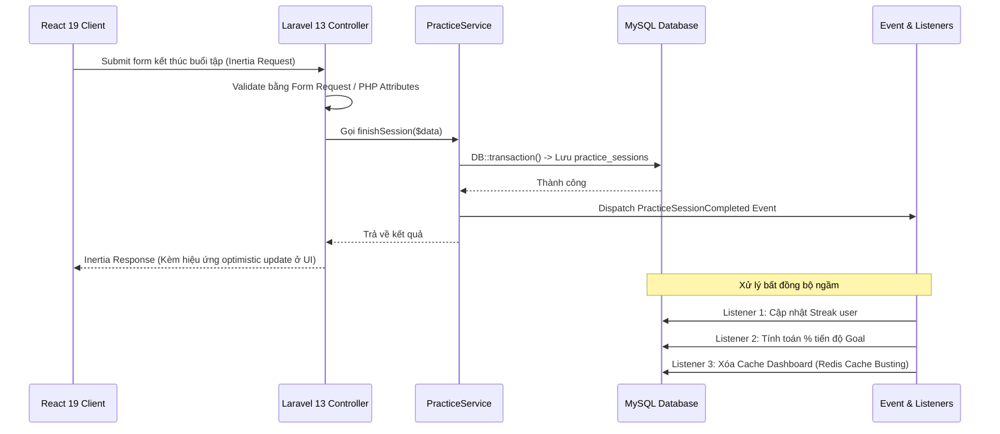
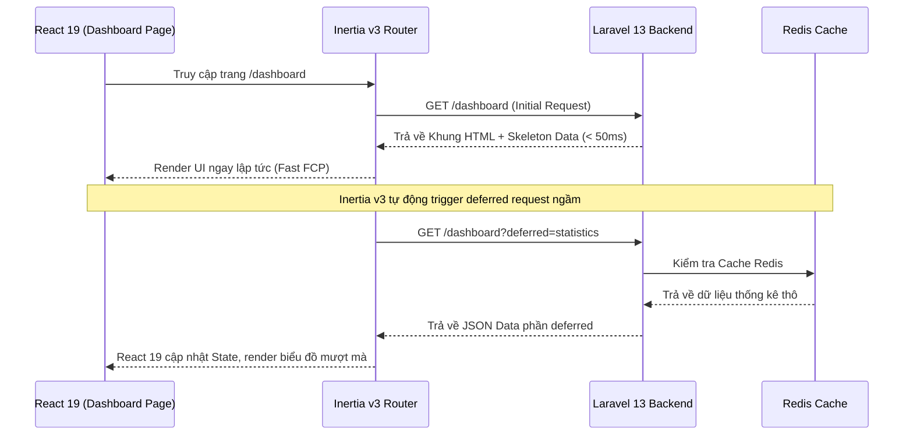

# TÀI LIỆU YÊU CẦU VÀ THIẾT KẾ KỸ THUẬT (RD)
## DỰ ÁN: MUSIC PRACTICE HUB (LARAVEL 13 - REACT 19 - INERTIA v3(Laravel 13.2 + React 19.2 + Inertia 3 + Vite 8))

---

## 1. TỔNG QUAN DỰ ÁN & CÔNG NGHỆ

* **Mục tiêu:** Xây dựng ứng dụng trợ lý luyện tập âm nhạc cá nhân, giải quyết triệt để vấn đề quản lý thói quen, bài tập, mục tiêu và theo dõi tiến độ học nhạc.
* **Backend:** Laravel 13.x (Tận dụng PHP 8.5 tối ưu hóa JIT, Native PHP Attributes như `#[Rule]`, `#[Locked]`, và Reverb tích hợp native driver mới).
* **Frontend:** React 19.2 (Sử dụng các hook mới như `useActionState`, `useOptimistic` để tối ưu trải nghiệm tương tác trực tiếp). Sử dụng tailwindcss để thiết kế giao diện.
* **Bridge (Cầu nối SPA):** Inertia.js v3 (Khai thác tối đa tính năng Deferred Props, Prefetching, và Polling để tải trang và cập nhật real-time mượt mà).
* **Database & Cache:** MySQL 8.0+ & Redis.

---

## 2. THIẾT KẾ CƠ SỞ DỮ LIỆU CHI TIẾT (DATABASE SCHEMA)

```mermaid
erDiagram
    users ||--o{ user_instruments : learns
    users ||--o{ user_songs : owns
    users ||--o{ practice_sessions : logs
    users ||--o{ practice_goals : sets
    instruments ||--o{ user_instruments : categorized
    instruments ||--o{ songs : belongs_to
    songs ||--o{ user_songs : mapped
    songs ||--o{ practice_goals : targets
    songs ||--o{ practice_sessions : practiced_in

    users {
        bigint id PK
        string name
        string email UK
        string password
        int daily_goal_minutes
        int current_streak
        int highest_streak
        timestamp created_at
    }

    instruments {
        bigint id PK
        string name UK
        string type
    }

    songs {
        bigint id PK
        string title
        string artist
        string genre
        bigint instrument_id FK
        string difficulty
        int default_target_bpm
    }

    practice_sessions {
        bigint id PK
        bigint user_id FK
        bigint song_id FK
        bigint instrument_id FK
        datetime start_time
        datetime end_time
        int duration_minutes
        int achieved_bpm
        decimal accuracy_rate
        text notes
        timestamp created_at
    }
```



### Mô tả chi tiết các bảng

- **users:** id, name, email, password, daily_goal_minutes, current_streak, highest_streak, timestamps.
- **instruments:** id, name, type (String, Keyboard, Wind...).
- **user_instruments:** id, user_id, instrument_id, level (beginner, intermediate, advanced).
- **songs:** id, title, artist, genre, instrument_id, difficulty, default_target_bpm.
- **user_songs:** id, user_id, song_id, instrument_id, status, progress_percentage.
- **practice_goals:** id, user_id, song_id, title, target_bpm, deadline_date, is_completed.
- **practice_sessions:** id, user_id, song_id, instrument_id, start_time, end_time, duration_minutes, achieved_bpm, accuracy_rate, notes, timestamps.

---

## 3. CHI TIẾT LUỒNG HỆ THỐNG (SYSTEM FLOWS)

### 3.1. Luồng Hoàn Thành Buổi Tập (Event-Driven & Transaction)



### 3.2. Luồng Tải Dữ Liệu Nặng với Inertia v3 Deferred Props



### 3.3. Các luồng bổ sung

- **Practice Session Flow:** Ghi nhận buổi tập qua Transaction, bắn Event `PracticeSessionCompleted`, các Listener chạy ngầm cập nhật Streak, tiến độ Goal và xóa Redis Cache (Cache Busting).
- **Dashboard Deferred Loading:** Khai thác tính năng Deferred Props của Inertia v3 kết hợp React 19 để render khung giao diện tức thì và tải dữ liệu thống kê nặng ngầm phía sau.
- **Asynchronous Import/Export:** Sử dụng Laravel Queue, LazyCollection và chunking để xử lý hàng chục ngàn bản ghi bài hát/lịch sử tập mà không lo tràn RAM (Memory Leak).

---

## 4. CẤU TRÚC THƯ MỤC CHUẨN (CLEAN ARCHITECTURE)

```
app/
├── Http/
│   ├── Controllers/          # Điều hướng mỏng, gọi Service
│   ├── Requests/             # Form Requests xác thực dữ liệu
├── Services/                 # Business Logic thuần túy
├── Repositories/             # Tầng truy vấn Eloquent
│   ├── Contracts/            # Interfaces chuẩn hóa (Loose Coupling)
│   ├── Eloquent/             # Triển khai thực tế các Repository
├── Events/                   # Định nghĩa sự kiện hệ thống
├── Listeners/                # Xử lý logic phụ thuộc sự kiện
├── Jobs/                     # Xử lý background queue (Import/Export)
└── Observers/                # Model Observers phục vụ Cache Busting
```

---

## 5. YÊU CẦU PHI CHỨC NĂNG

- **Hiệu năng:** Thời gian phản hồi API/Inertia request dưới 200ms (tối ưu với Redis cache). Triệt tiêu 100% lỗi N+1 Query thông qua Eager Loading và giám sát bằng Laravel Telescope.
- **Kiểm thử:** Sử dụng Pest PHP với bộ cơ sở dữ liệu SQLite in-memory (`:memory:`) đảm bảo độ phủ code (Code Coverage) > 70%.
- **Deployment:** Vận hành trên VPS Linux (Ubuntu).
